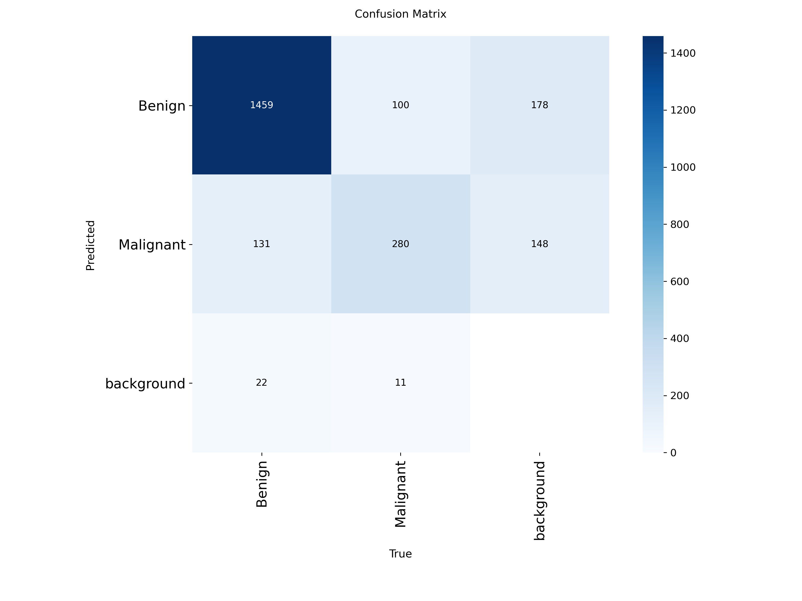
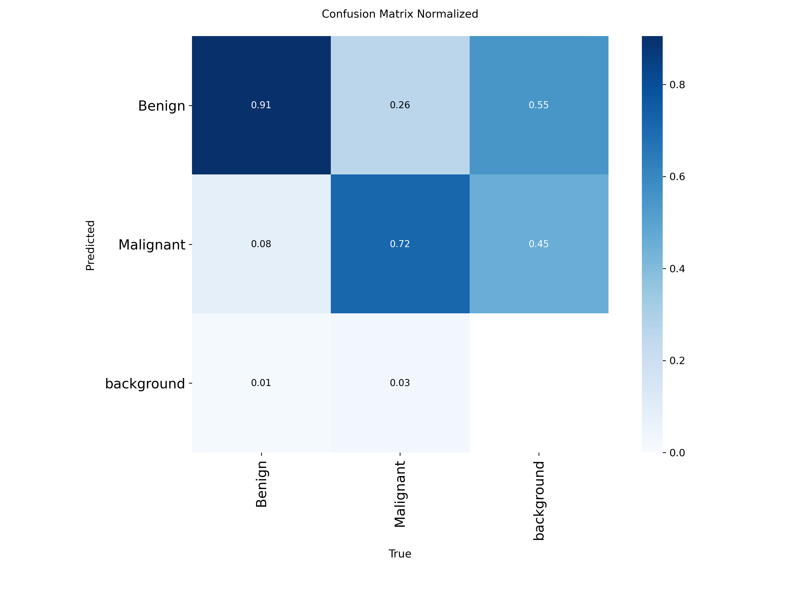
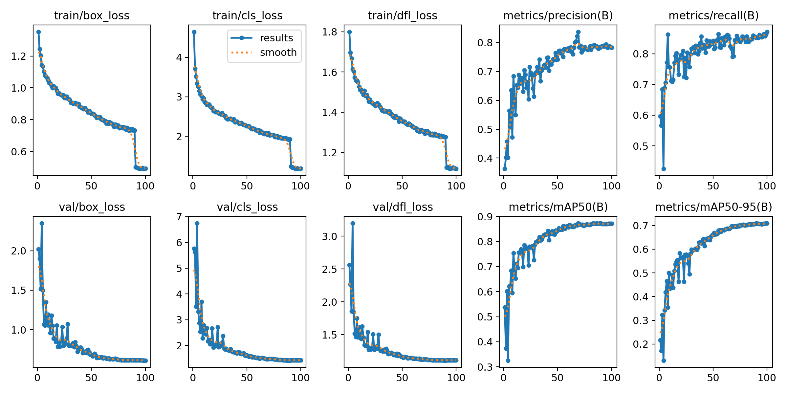

# HAM10000 Skin Lesion Classification using YOLOv8 and Hailo-8L

**Deep Learning | Computer Vision | Edge AI | Medical Image Analysis | Hardware Acceleration**

An end-to-end Edge AI project exploring binary skin lesion detection using the HAM10000 dataset, YOLOv8 and the Hailo-8L AI accelerator. The trained model is converted into ONNX format, compiled into Hailo Executable Format (HEF), and deployed on Raspberry Pi 5 for live camera inference.

The project demonstrates the complete workflow of developing a deep learning model and deploying it on dedicated edge AI hardware.

---

## 1. Project Overview

Skin lesion analysis is an important application of computer vision in medical imaging. Deep learning provides the ability to learn visual patterns from dermatoscopic images and identify different lesion categories.

The objective of this project is to develop an AI-based system that distinguishes between two skin lesion categories:

- **Benign**
- **Malignant**

The project uses YOLOv8 for model training and the Hailo-8L accelerator for hardware-accelerated inference.

Unlike a conventional deep learning project that ends with model training and evaluation, this implementation extends to model conversion, hardware compilation and deployment on Raspberry Pi 5.

### Project Highlights

- HAM10000-based skin lesion dataset preparation.
- Binary Benign vs Malignant detection.
- YOLOv8 model training using transfer learning.
- Dataset annotation and preprocessing.
- Model evaluation and confusion matrix analysis.
- ONNX model export.
- Hailo Dataflow Compiler Studio for model parsing.
- HEF generation for Hailo-8L.
- Live camera inference on Raspberry Pi 5.
- CPU and accelerator utilization monitoring.

---

## 2. Technology Stack

| Category | Technology |
|---|---|
| Programming Language | Python |
| Deep Learning Framework | PyTorch |
| Model Framework | Ultralytics YOLO |
| Model Architecture | YOLOv8 |
| Dataset | HAM10000 |
| Model Export | ONNX |
| Model Compilation | Hailo Dataflow Compiler |
| AI Accelerator | Hailo-8L |
| Deployment Hardware | Raspberry Pi 5 |
| Inference Runtime | HailoRT |
| Development Environment | Ubuntu Linux |

---

## 3. Dataset

The project uses a binary-labelled dataset derived from HAM10000 (Human Against Machine with 10000 training images).

The original HAM10000 dataset contains approximately 10,000 dermatoscopic images belonging to seven diagnostic categories.

For this project, the target classes are:

| Class ID | Category |
|---|---|
| 0 | Benign |
| 1 | Malignant |

The original HAM10000 diagnostic categories include:

| Abbreviation | Diagnosis |
|---|---|
| AKIEC | Actinic keratoses and intraepithelial carcinoma |
| BCC | Basal cell carcinoma |
| BKL | Benign keratosis-like lesions |
| DF | Dermatofibroma |
| MEL | Melanoma |
| NV | Melanocytic nevi |
| VASC | Vascular lesions |

The binary dataset is used for training the detection model.

**Original dataset reference:**

https://www.kaggle.com/datasets/tschandl/ham10000-lesion-segmentations

The dataset is not included in this repository. Please obtain it separately and follow its applicable licensing and usage conditions.

---

## 4. Model Development

### YOLOv8

The project uses the Ultralytics YOLOv8 architecture for binary skin lesion detection.

The training implementation initializes a pretrained YOLOv8 Nano model and fine-tunes it using the prepared dataset.

The model is configured to detect two categories:

- Benign
- Malignant

### Training Configuration

The following parameters are used in the training implementation:

| Parameter | Value |
|---|---|
| Initial model | YOLOv8n |
| Training epochs | 100 |
| Early stopping patience | 20 |
| Image size | 640 × 640 |
| Batch size | 16 |
| Optimizer | SGD |
| Initial learning rate | 0.001 |
| Final learning rate factor | 0.01 |
| Momentum | 0.937 |
| Weight decay | 0.0005 |
| Learning rate scheduler | Cosine |
| Warmup epochs | 3 |
| Mixed precision | Enabled |
| Number of classes | 2 |

### Data Augmentation

The training configuration includes:

- Horizontal flipping
- Vertical flipping
- HSV augmentation
- Image rotation
- Translation
- Scaling
- Mosaic augmentation
- MixUp augmentation

These techniques are used to introduce variations during training and improve the model's ability to generalize.

### Training Implementation

The main training implementation is available in:

`code/train3.py`

Other model development files include:

- `code/annotate.py` — dataset annotation workflow.
- `code/export.py` — model export workflow.
- `code/best.pt` — trained model checkpoint.

---

## 5. Model Evaluation

The trained model is evaluated using classification and detection performance visualizations.

The repository includes:

- Confusion matrix.
- Normalized confusion matrix.
- Training results and performance plots.

### Confusion Matrix



### Normalized Confusion Matrix



### Training Results



These visualizations help examine the model's performance across the two target categories.

The project also highlights an important limitation: class imbalance in the dataset can influence model performance, particularly its ability to recognize the less represented category.

---

## 6. ONNX Model Export

After training, the model is exported into ONNX format.

ONNX provides an interoperable representation of the trained model and serves as the input to the Hailo compilation workflow.

The exported model is subsequently parsed and optimized using the Hailo toolchain.

The model export implementation is available in:

`code/export.py`

---

## 7. Hailo-8L Model Compilation

One of the main components of this project is deploying the trained deep learning model using the Hailo-8L AI accelerator.

The ONNX model is converted into Hailo Executable Format (HEF), which can be executed through HailoRT.

### Compilation Workflow

The conversion process involves the following stages:

1. Export the trained model into ONNX format.
2. Prepare representative calibration images.
3. Launch Hailo Dataflow Compiler Studio.
4. Upload and parse the ONNX model.
5. Inspect the original ONNX computation graph.
6. Inspect the generated Hailo computation graph.
7. Identify the correct starting and ending nodes.
8. Compile the model for Hailo-8L.
9. Generate the final HEF file.

### Launching Hailo Dataflow Compiler Studio

```bash
hailo dfc-studio
```

The local address displayed in the terminal can be opened in a web browser.

Upload the ONNX model and inspect the computation graph before proceeding with compilation.

### HEF Compilation

An example Hailo Model Zoo compilation command is:

```bash
hailomz compile yolov8s \
    --ckpt best.onnx \
    --calib-path /path/to/calibration/images \
    --hw-arch hailo8l \
    --classes 2 \
    --start-node-names images \
    --end-node-names "<verified-output-node-names>"
```

The model variant, input node, output nodes and compilation options must match the actual exported ONNX graph and installed Hailo Model Zoo version.

The Hailo compilation process can encounter errors due to:

- Incorrect starting or ending node names.
- Incorrect model architecture configuration.
- Incorrect file paths.
- Incorrect class-label configuration.
- Incompatible model or compiler versions.

### Hailo Documentation

Detailed implementation notes and deployment documentation are available in the `hailo docs/` directory.

---

## 8. Raspberry Pi 5 Deployment

The compiled HEF model is deployed on Raspberry Pi 5 with the Hailo-8L AI accelerator.

The objective is to perform inference using a live camera input rather than relying only on previously recorded images or videos.

### Hardware Components

- Raspberry Pi 5.
- Hailo-8L AI accelerator.
- Compatible Raspberry Pi camera.
- MicroSD card.
- Compatible power supply.

### Live Camera Inference

The Hailo detection application is used to capture camera frames and perform inference.

The following command was used for live inference:

```bash
hailo-detect \
    --hef-path /path/to/yolov8s.hef \
    --input rpi \
    --labels-json /path/to/labels.json
```

The application processes the camera input and displays detection results with bounding boxes, class labels and confidence scores.

### Label Configuration

The Hailo detection application uses a JSON configuration similar to:

```json
{
    "detection_threshold": 0.5,
    "max_boxes": 200,
    "labels": [
        "Unlabeled",
        "Benign",
        "Malignant"
    ]
}
```

The additional Unlabeled entry is used by the detection application's label configuration. It is not a third trained lesion category.

The label ordering must match the model output and runtime configuration.

For complete live inference instructions, refer to:

[`live_inference.md`](live_inference.md)

---

## 9. Hardware Utilization

During live inference, CPU usage and Hailo accelerator utilization were monitored.

The documented deployment session recorded the following observations:

| Metric | Observed Value |
|---|---:|
| Maximum CPU utilization | Approximately 25% |
| Hailo accelerator utilization | Approximately 50% |

These observations demonstrate the use of dedicated AI acceleration hardware for inference without relying exclusively on the Raspberry Pi CPU.

The values represent observations from the documented test session, not standardized performance benchmarks.

A more comprehensive evaluation could include:

- Average inference latency.
- Frames per second (FPS).
- CPU utilization over time.
- Hailo accelerator utilization over time.
- Power consumption.
- Quantized model accuracy.

---

## 10. Repository Structure

```text
hailo-ham10000-skin-lesion-classification/
│
├── README.md
├── live_inference.md
│
├── code/
│   ├── annotate.py
│   ├── best.pt
│   ├── export.py
│   └── train3.py
│
├── Results/
│   ├── confusion_matrix.png
│   ├── confusion_matrix_normalized.png
│   └── results.png
│
└── hailo docs/
    ├── execution.pdf
    └── Using Hailo computation power with Raspberry pi
        to run Deep learning models.pdf
```

---

## 11. Limitations

- The original HAM10000 dataset has an imbalanced class distribution.
- Mapping seven diagnostic categories into two broad categories may introduce ambiguity.
- Detection performance depends on the quality and consistency of bounding-box annotations.
- Performance on the training dataset does not guarantee generalization to independent clinical data.
- Hardware quantization and compilation may affect model accuracy.
- The project has not been clinically validated.

---

## 12. Future Improvements

- Improve class imbalance handling.
- Investigate additional lightweight deep learning architectures.
- Explore quantization and model optimization strategies.
- Evaluate inference latency and throughput under controlled conditions.
- Improve real-time camera processing.
- Investigate model explainability techniques.
- Evaluate generalization using independent dermatoscopic datasets.

---

## 13. References

1. Ultralytics YOLO Documentation: https://docs.ultralytics.com/

2. Hailo Developer Zone: https://hailo.ai/developer-zone/

3. R. Bhuvaneswari and P. C. V. S. Raman, "Enhancing Skin Cancer Diagnosis with AlexNet Convolutional Neural Networks," 2023 International Conference on Integrated Intelligence and Communication Systems (ICIICS), Kalaburagi, India, 2023, pp. 1-5, doi: 10.1109/ICIICS59993.2023.10421461. keywords: {Squamous cell carcinoma;Image recognition;Basal cell carcinoma;Melanoma;Skin;Lesions;Medical diagnostic imaging;Skin cancer;Melanoma;Benign;Malignant;dermatoscopic images},


---

## Disclaimer

This project is developed for educational and experimental research purposes only.

It is not a clinically validated medical diagnostic system and must not be used to diagnose skin cancer or make medical treatment decisions.

---

**Project Focus:** Deep Learning | Computer Vision | Edge AI | Hardware Acceleration

**Deployment Platform:** Raspberry Pi 5 + Hailo-8L AI Accelerator
